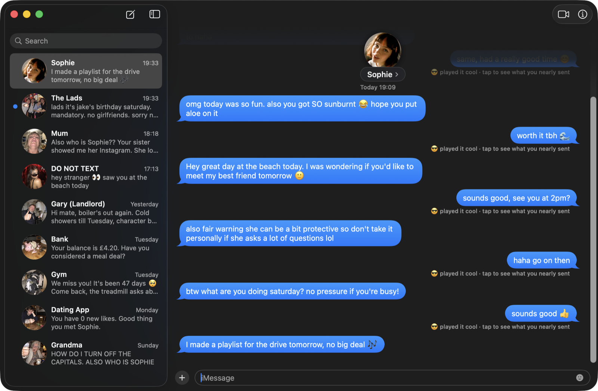
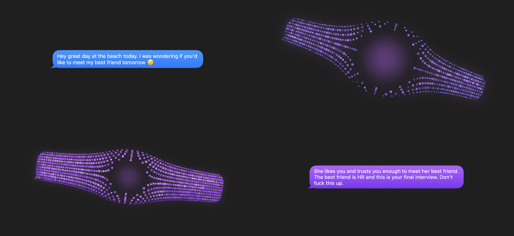
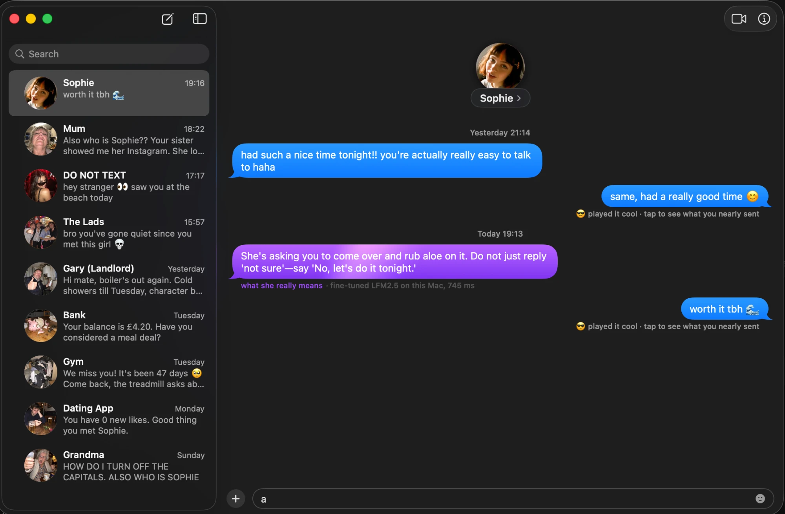
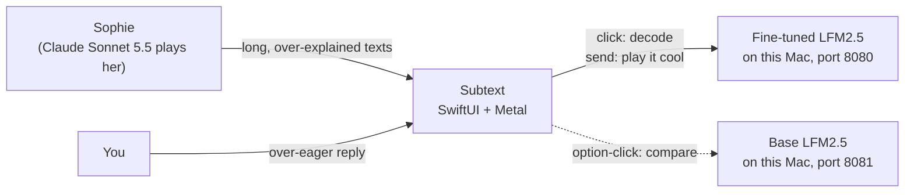

# Subtext

**She said "no pressure". Subtext knows what she meant.**



Subtext is a fake iMessage for Mac. Her texts arrive looking completely normal. Click one and it flips round in 3D, goes to jelly, melts purple and lands as a bubble that says what she *really* means. Your own over-eager replies get rewritten to play it cool before they "send".

Both jobs run on a 1.2-billion-parameter model fine-tuned for exactly this, on the laptop, with no cloud calls.

> *"Hey great day at the beach today. I was wondering if you'd like to meet my best friend tomorrow 🙂"*
>
> **What she really means:** She likes you and trusts you enough to meet her best friend. The best friend is HR and this is your final interview. Don't fuck this up.

Built in three hours at a London hackathon (22 October 2026). Every team got the same small model (Liquid AI's **LFM2.5**, 1.2B parameters), one GPU, White Circle's **Halo** fine-tuning framework, and one rule: the finished app runs locally.

---

## The decode



Custom Metal shaders on SwiftUI views (`Subtext/Shaders.metal`):

- **Flip and morph:** the bubble turns away in 3D while a jelly distortion wobbles it and it melts purple; the text swaps edge-on, and it swings back with an overshoot while the words decrypt.
- **Shockwave:** a ripple with RGB split rolls through the whole conversation from where you clicked.
- **Sheen:** a slow light sweep keeps decoded bubbles alive.

The real iMessage sounds play throughout: the soft blip when she texts, the whoosh when you send, the tri-tone when someone else texts, and the Spotlight effect on every decode.

## Two jobs, one small model

| Job | In | Out |
|---|---|---|
| **Decode** | Her text | One or two lines of blunt Gen Z advice about what she means |
| **Play it cool** | His over-eager text | 12 words or fewer, every time, place and answer kept |

> **He typed:** "Oh wow that would be great!! I bet she's amazing just like you. Is 2pm ok? Honestly any time works, I'll bring snacks for everyone, I'm so excited"
>
> **He sent:** awesome, see you at 2pm?

The model we trained uses one system prompt for both jobs (`Prompts.trained` in `Subtext/Translator.swift`, copied from the checkpoint's `run_local.py`). It tells the jobs apart by how a message looks, so the app sends his drafts in capitals, as in its rewrite examples, and falls back to a rule-based line if a rewrite comes back as a decode. `data/PROMPT.md` writes two-prompt data for the next run; if you retrain with it, update `Prompts.trained` to match.

**Why fine-tune?** An untuned small model reads her text as a message to answer, not to decode. In our first test, one replied to the best-friend text with "Oh, I'm all ears! Let's plan a beach date! 😊". The fine-tuned model learns the job, the voice, and the hard rules: the cool version never drops a time or invents a fact.

**Running live.** Here's our fine-tuned LFM2.5 on a MacBook, decoding Sophie's "hope you put aloe on it" in 745 ms. The caption under the bubble shows which model answered and how long it took.



## How it fits together



- **The product runs locally.** Decode and play it cool go to the fine-tuned model on `localhost`, through any OpenAI-compatible server (llama.cpp or MLX).
- **Sophie is the test harness.** Claude Sonnet 5.5 plays the girlfriend, so the demo has someone to talk to. Every reply is a 70 to 130 word over-explanation with one real meaning buried in the middle: she's free Saturday, she wants you to call, your reply was too short. There are eight buried meanings, in `Subtext/Her.swift`.
- **Everyone else interrupts.** After every second text you send Sophie, someone else chimes in: the Lads ("jake's birthday saturday. mandatory. no girlfriends"), Grandma in capitals, the ex ("u up? 👀"). Their chat jumps up the list with an unread dot; Sophie stays open. Click their texts to decode them too.
- **It never breaks on stage.** With no model running, every message falls back to a scripted line written for it. With no Anthropic key, Sophie sends her next scripted text.

## Run it

You need macOS 14 or later and Xcode.

1. Open `Subtext.xcodeproj` and press ⌘R. If Xcode asks for its Metal toolchain, run `xcodebuild -downloadComponent MetalToolchain`.
2. **Optional, the model:** put the fine-tuned model in `Models/` and run `./serve.sh` in a Terminal tab (details below).
3. **Optional, Sophie live:** add an Anthropic API key once. It stays in your Mac's preferences, never in git:

```bash
defaults write com.owenbarnes.subtext AnthropicAPIKey 'sk-ant-...'
```

To use a different Claude model: `defaults write com.owenbarnes.subtext SubtextHerModel 'claude-opus-5-5'`.

If you edit `project.yml`, regenerate the project with `xcodegen generate`.

### Demo controls

| Do this | What happens |
|---|---|
| ⌘→ | Sophie sends her next scripted message (typing dots first) |
| Click her bubble | Decode: 3D flip, jelly morph, purple translation |
| Type and press Return | You send; it plays it cool automatically. Click it to see what you nearly sent 💀 |
| Type, then ⌥↩ | Sends your draft **as her**, so a judge can write one live |
| ⌥-click her bubble | Asks the **base** model instead, for the side-by-side |
| ⌘⇧S | Prefer scripted lines (safe mode if the model misbehaves) |
| Demo › She Replies Automatically | On by default: she answers every text you send |
| ↺ or ⌘⇧R | Reset the demo |

Launch with `-autoplay` (add `-reply`) to rehearse hands-free.

### A three-minute demo

1. **⌘→:** Sophie asks if you'd like to meet her best friend. Click it. *"The best friend is HR and this is your final interview."*
2. **Type an essay back**, all exclamation marks and snacks. Watch it become "awesome, see you at 2pm?".
3. **Sophie replies with a paragraph** about her flatmate, her cat and her mum. Click it: the one thing she actually meant falls out.
4. **The Lads interrupt.** Saturday is now a war.
5. **Hand the keyboard to a judge:** they write a text as her with ⌥↩, and it decodes live, on the laptop.
6. **⌥-click the same text** to show what the base model makes of it.

## The models

`serve.sh` starts the fine-tuned model on port 8080 and the base model on 8081, and the app finds them on its own.

- **Straight from Halo:** copy the final checkpoint folder (the one with `config.json`, `model.safetensors` and the tokenizer files) to `Models/subtext/`. It's served with MLX (`uv tool install mlx-lm` once). If you trained a LoRA, merge it into the base first: Halo saves LoRA as an adapter only.
- **Or a GGUF file:** `Models/subtext.gguf`, served with llama.cpp.
- **The base model** is `Models/base/` or `Models/base.gguf` if you add one, otherwise Liquid's `LFM2.5-1.2B-Instruct-GGUF` (Q4_K_M, about 0.7 GB), downloaded once.

Logs go to `logs/`. Ports and labels can be overridden in the Xcode scheme (Edit Scheme › Run › Environment): `SUBTEXT_URL`, `SUBTEXT_BASE_URL`, `SUBTEXT_MODEL` and `SUBTEXT_LABEL`.

## Training data and evaluation

1. **Write the data.** `data/PROMPT.md` is a prompt for any strong LLM, with 40 themes from "meeting her parents" to "'k'". Run it once per theme and save each reply to `data/raw/batch-NN.jsonl`. Forty runs of 50 lines gives about 2,000 examples.
2. **Check it.** `python3 data/check.py` drops malformed lines, cool rewrites over 12 words, cool rewrites that lose a time, and duplicates. It then writes `data/train.jsonl` and a held-out `data/eval.jsonl`.
3. **Train.** Halo SFT on `data/train.jsonl`. Records use Halo's default `prompt` column. Set `assistant_message_template: "<|im_start|>assistant\n"`, which matches LFM2.5's chat template, so only the answers are trained.
4. **Compare.** With both models served, `python3 data/compare.py` runs the held-out set through base and fine-tuned, and writes `data/compare.md`: pass rates, median latency and a side-by-side table for the slides.

The data rules keep it funny without being nasty:
- The joke is always on him, never on her.
- About one in six of her texts is literal: "She wants milk. Not everything is a test. Get the milk."
- Decodes never advise games, jealousy or ignoring a boundary.

## What's in the box

```
Subtext/
  Views.swift        the Messages look: sidebar, floating header, bubbles, composer
  Shaders.metal      morph, shockwave and sheen
  ChatStore.swift    conversation state, the demo flow, interruptions
  Translator.swift   the local model client and the trained system prompt
  Her.swift          Sophie: the Claude prompt and her eight buried meanings
  Model.swift        conversations, scripted lines and decodes
  Sounds.swift       the iMessage sounds
  Resources/         avatars
data/                training-data prompt, checker and base-vs-tuned comparison
serve.sh             starts the local model servers
Models/              drop the fine-tuned model here (not committed)
project.yml          XcodeGen spec for Subtext.xcodeproj
```

## Notes

- **Apple's sounds aren't in this repo.** The build copies the iMessage sounds from your Mac's iOS simulator runtime, and the decode sound is read from macOS itself. On a Mac without them, Subtext uses standard system sounds.
- **The supporting cast is AI-generated.** Mum, the Lads, Gary the landlord and friends are made with GPT image generation. Replace any avatar by swapping `Subtext/Resources/<name>.jpg`.
- **Everything stays on the Mac** except Sophie's own lines when an Anthropic key is set.
